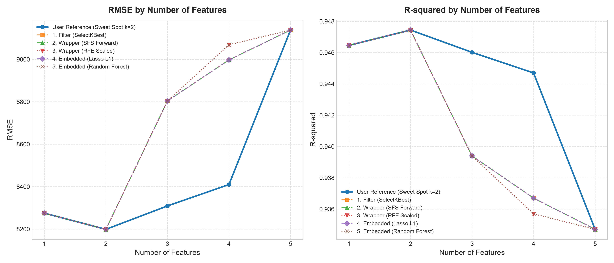

# 50 Startups 多元線性迴歸與特徵選擇互動分析專案 (CRISP-DM)

本專案遵循國際標準資料探勘方法論 **CRISP-DM (Cross-Industry Standard Process for Data Mining)**，使用 Python 與 **Scikit-Learn** 針對 50 家新創公司的營運與研發數據建立**多元線性迴歸 (Multiple Linear Regression)** 獲利預測模型。

專案深入實作並評估了機器學習領域最核心的 **Top 5 特徵選擇 (Feature Selection)** 演算法（涵蓋 Filter、Wrapper 與 Embedded 三大流派），實證找出**特徵數最佳甜點區 ($k=2$)**，並建立美觀的**響應式互動視覺化儀表板 (Interactive Web Dashboard)**。

---

## 🌐 互動展示網頁 (Interactive Demo)

本專案附帶可獨立執行的互動式網頁應用程式，具備 **Chart.js 動態走勢圖**、**Top 5 演算法多線切換比對** 與 **新創公司利潤即時推論計算機**。

* **本地即時預覽**：直接雙擊開啟工作目錄中的 [`index.html`](./index.html)。
* **本地 HTTP 伺服器啟動方式**（推薦）：
  ```powershell
  # 在專案目錄下啟動輕量 Web 服務
  python -m http.server 8000
  ```
  啟動後於瀏覽器訪問：[http://localhost:8000/index.html](http://localhost:8000/index.html)

---

## 📊 核心實驗結論與走勢分析



透過逐步增減特徵數量（$k=1 \dots 5$）進行模型泛化能力評估，發現了極為顯著的規律：

| 特徵數量 ($k$) | 選取的特徵集合 (Selected Features) | 測試集 RMSE | 測試集 $R^2$ | 模型狀態說明 |
|:---:|---|:---:|:---:|:---:|
| **1** | `['R&D Spend']` | \$8,274.87 | 0.946459 | 基準單變數模型 |
| **2 ⭐ (最佳)** | `['R&D Spend', 'Marketing Spend']` | **\$8,198.80** (最低谷) | **0.947439** (最高峰) | **最佳全域甜點區 (Sweet Spot)** |
| **3** | `['R&D Spend', 'Marketing Spend', 'State_New York']` | \$8,309.06 | 0.946015 | 雜訊開始引入，誤差回升 |
| **4** | `['R&D Spend', 'Marketing Spend', 'State_NY', 'State_FL']` | \$8,409.92 | 0.944697 | 虛擬變數共線性增加 |
| **5 (全特徵)** | `['R&D', 'Mkt', 'Admin', 'State_FL', 'State_NY']` | \$9,137.99 (最高) | 0.934707 (最低) | 過擬合嚴重，泛化能力最差 |

### 核心洞察 (Key Insights)：
1. **奧卡姆剃刀原則 (Occam's Razor)**：模型並非特徵越多越好！特徵數超過 2 個後，加入的地理變數與行政支出反而帶來了統計噪聲與多重共線性，造成測試集 RMSE 攀升。
2. **獲利黃金雙引擎**：新創公司的獲利預測有 **94.7% 以上** 的變異純粹由 **「研發支出 (R&D Spend)」** 與 **「行銷推廣 (Marketing Spend)」** 驅動。
3. **商業決策意涵**：創投與管理層應將 80% 以上資源集中配置於產品研發與市場開拓，行政管理成本維持在必要低點，公司所在州別在統計檢定上未達顯著差異。

---

## 🔬 Top 5 特徵選擇方法對照表

專案整合並實測了以下 5 大經典特徵選擇演算法，**所有演算法在 $k=2$ 時全部一致鎖定 `['R&D Spend', 'Marketing Spend']`**：

| # | 演算法名稱 | 類型 (Paradigm) | Scikit-Learn 實作模組 | 特性與機制 |
|---|---|---|---|---|
| **1** | **SelectKBest (F-Regression)** | **Filter (過濾法)** | `sklearn.feature_selection.SelectKBest` | 單變數統計檢定，計算每個特徵與目標變數之 F 檢定分數，獨立挑選 Top-K。速度最快。 |
| **2** | **SFS (Forward)** | **Wrapper (封裝法)** | `sklearn.feature_selection.SequentialFeatureSelector` | 循序前向逐步選擇，每回合透過交叉驗證（CV）加入能最大化驗證分數的特徵。 |
| **3** | **RFE (Standardized)** | **Wrapper (封裝法)** | `sklearn.feature_selection.RFE` | 遞迴特徵消除法，以線性迴歸標準化係數絕對值 $|\beta_i|$ 迭代剔除貢獻最低者。 |
| **4** | **Lasso (L1 Regularization)** | **Embedded (嵌入法)** | `sklearn.linear_model.LassoCV` | 透過 L1 稀疏約束懲罰項，自動將無顯著關聯或共線性的特徵係數直接壓縮歸零。 |
| **5** | **Random Forest (MDI)** | **Embedded (嵌入法)** | `sklearn.ensemble.RandomForestRegressor` | 隨機森林不純度縮減重要性（Mean Decrease in Impurity），具備捕捉特徵交互作用能力。 |

---

## 🛠️ CRISP-DM 六大階段實施細節


1. **Business Understanding (業務理解)**：
   * 確立商業痛點：創投如何根據新創收支預測公司獲利？
   * 確立指標：最佳化判定係數 $R^2$ 與均方根誤差 $\text{RMSE}$。
2. **Data Understanding (資料理解)**：
   * 讀取 50 筆新創數據（無缺失值）。
   * 相關係數探索：R&D Spend 相關性達 $0.9729$、Marketing Spend 為 $0.7478$、Administration 僅 $0.2007$。
3. **Data Preparation (資料準備)**：
   * 使用 `OneHotEncoder(drop='first')` 處理類別欄位 `State`，防範虛擬變數陷阱（Dummy Variable Trap）。
   * 實作 Top 5 特徵選擇演算法評估。
4. **Modeling (模型建立)**：
   * 使用 `ColumnTransformer` + `SequentialFeatureSelector` + `LinearRegression` 封裝成標準端到端 `Pipeline`，嚴防資料外洩（Data Leakage）。
5. **Evaluation (評估)**：
   * 比較全特徵基準與特徵選擇模型；在測試集上 Adjusted $R^2$ 由 $0.7721$ 大幅跃升至 $0.8501$。
6. **Deployment (部署)**：
   * 透過 `joblib` 將 Pipeline 持久化為 `50_startups_pipeline.joblib`。
   * 內建線上推論 API 範例，新輸入資料可自動完成編碼、篩選並產出利潤預測。

---

## 📂 專案檔案結構 (Project Structure)

```text
DIC2/
├── 50_startups_crisp_dm.py              # CRISP-DM 六大階段主程式 (含 Pipeline 與部署展示)
├── plot_feature_selection_comparison.py # Top 5 特徵選擇 k=1..5 走勢計算與繪圖腳本
├── 50_startups_pipeline.joblib          # 訓練完成之端到端持久化模型檔
├── feature_selection_curves.png         # 特徵數量 vs RMSE & R² 趨勢圖 (高解析度)
├── index.html                           # 現代化響應式互動分析儀表板
└── README.md                            # 專案總結說明文件
```

---

## 🚀 快速上手 (Quick Start)

### 1. 環境需求
* Python 3.9+
* 相依套件安裝：
  ```powershell
  pip install numpy pandas scikit-learn matplotlib joblib
  ```

### 2. 執行 CRISP-DM 完整流程主程式
```powershell
python 50_startups_crisp_dm.py
```

### 3. 重新計算特徵曲線並產出圖表
```powershell
python plot_feature_selection_comparison.py
```

### 4. 啟動互動式 Web 儀表板
```powershell
# 直接在瀏覽器中打開
start index.html
# 或啟動本地 HTTP Server
python -m http.server 8000
```

---

## 📚 參考資料與致謝 (Acknowledgements & References)

1. **資料集來源 (Dataset Source)**:
   * 感謝 Hari Mittapalli 提供之開源資料集：[Mulitple-Linear-Reggression / 50_Startups.csv](https://github.com/harimittapalli/Mulitple-Linear-Reggression)
   * Raw URL: `https://github.com/harimittapalli/Mulitple-Linear-Reggression/raw/master/50_Startups.csv`
2. **方法論規範 (Methodology)**:
   * **CRISP-DM (Cross-Industry Standard Process for Data Mining)**: 跨行業資料探勘標準流程。
3. **開源技術棧 (Open Source Ecosystem)**:
   * [Scikit-Learn](https://scikit-learn.org/): 機器學習迴歸模型與特徵選擇模組。
   * [Pandas](https://pandas.pydata.org/) & [NumPy](https://numpy.org/): 高效數據操作與矩陣運算。
   * [Matplotlib](https://matplotlib.org/): 科學視覺化圖表生成。
   * [Chart.js](https://www.chartjs.org/): 網頁互動式圖表渲染引擎。
   * [Tailwind CSS](https://tailwindcss.com/): 響應式現代化 UI 樣式庫。

